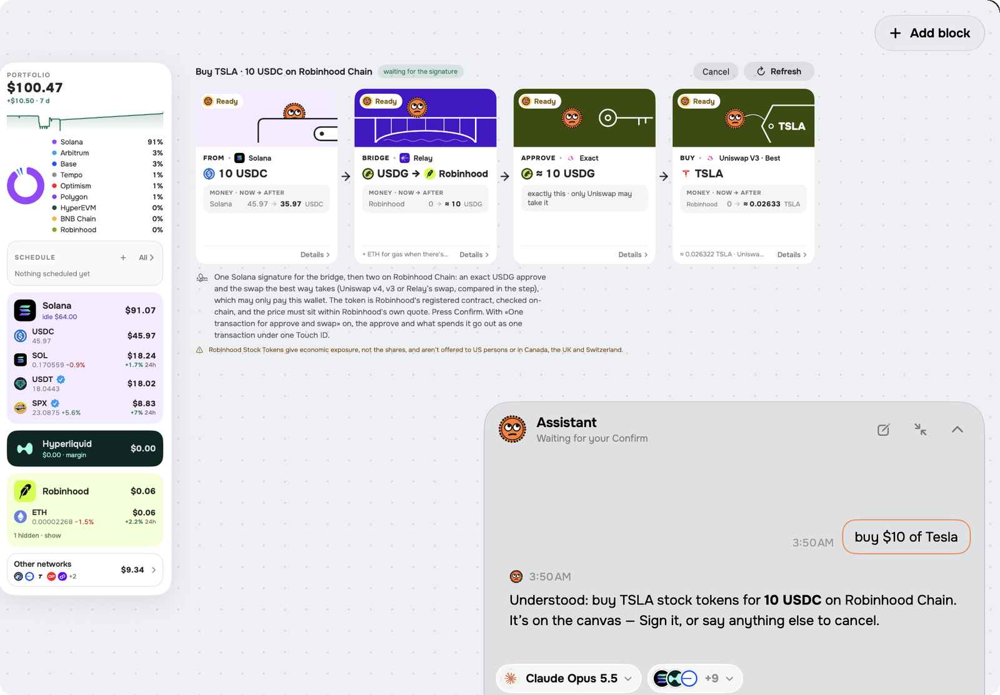
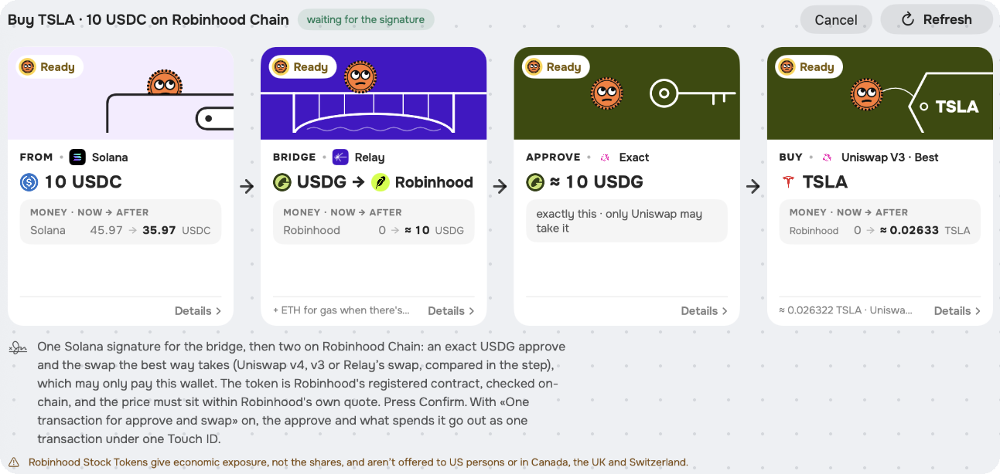
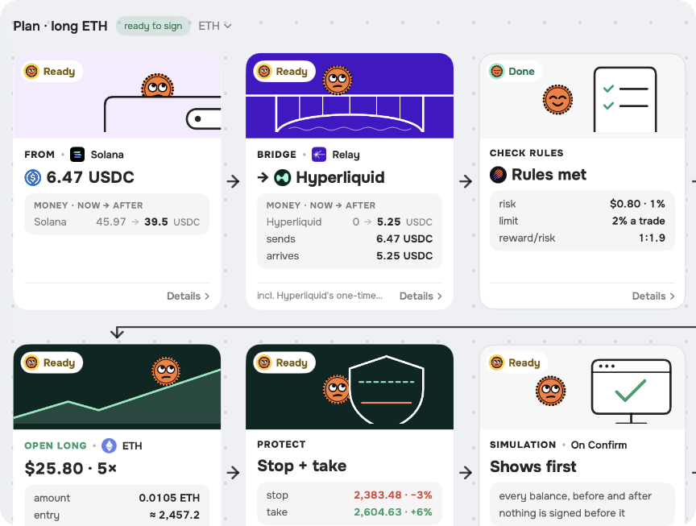

<p align="center">
  <picture>
    <source media="(prefers-color-scheme: dark)" srcset="images/hero-dark.png">
    
  </picture>
</p>

<p align="center">
  Say what you want done with your crypto. ihatecrypto lays the move out as cards, and nothing moves until you confirm with Touch ID.
</p>

<p align="center">
  <a href="LICENSE"></a>
  
  <a href="https://ihatecrypto.ai"></a>
</p>

ihatecrypto is a self-custody Mac wallet you talk to. Write «buy $10 of Tesla» or «put my USDC where it earns most»
in English, Spanish or Russian. It looks up prices and balances, picks a route across networks and shows where the
money comes from, how it gets there and what you end up with. The model never holds a key: a separate signing
process checks every transaction in code and signs only after you press Confirm.

## What it does

<table>
  <tr>
    <td width="50%" valign="top">
      <picture>
        <source media="(prefers-color-scheme: dark)" srcset="images/route-dark.png">
        
      </picture>
    </td>
    <td width="50%" valign="top">
      <h3>Say it, see the route</h3>
      <p>Every move is a row of cards: the source, each bridge and swap with its fee, and the balance after. Set the
      amount with the slider over the chat field. A move the wallet can't pay for is turned down before any card
      appears.</p>
      <h3>Keys stay on the Mac</h3>
      <p>The wallet is made on the Mac and sealed with a Secure Enclave key. Signing runs in its own process with no
      network: it parses each transaction, refuses unlimited approvals, permits and blind signatures, and asks for
      Touch ID. A Ledger and a Safe multisig work too.</p>
    </td>
  </tr>
  <tr>
    <td width="50%" valign="top">
      <picture>
        <source media="(prefers-color-scheme: dark)" srcset="images/trade-dark.png">
        
      </picture>
    </td>
    <td width="50%" valign="top">
      <h3>Trading with rules</h3>
      <p>Hyperliquid perps on crypto, oil and stocks, sized so a stop costs at most 2% of your capital (you can change
      the limit in Settings). The stop and the take go in with the order. Price alerts and scheduled buys keep
      running from the menu bar when the window is closed.</p>
      <h3>Bring your own model</h3>
      <p>A ChatGPT Plus or Pro plan, a Claude plan through Claude Code, OpenRouter, an API key, or a model on your Mac
      through Ollama. ihatecrypto has no model of its own, and your chat goes from the Mac to the model you pick.</p>
    </td>
  </tr>
</table>

**Networks:** Solana, Hyperliquid, Ethereum, Base, Arbitrum, Optimism, Polygon, BNB Chain, HyperEVM, Robinhood Chain,
Tempo and NEAR; Bitcoin and others through NEAR Intents.
**Protocols:** Jupiter, Uniswap, Relay, NEAR Intents, CCTP, USDT0, Aave, Kamino, Jupiter Lend, JitoSOL, Morpho and
Hyperliquid's HLP.

## Install

**Download:** get the DMG from [Releases](../../releases/latest) or [ihatecrypto.ai](https://ihatecrypto.ai) and drag
ihatecrypto into Applications. It's free and runs on macOS 26 or later. Every version is on the
[Releases](../../releases) page with its notes and DMG. Updates come through Sparkle from updates.ihatecrypto.ai,
signed with the project's EdDSA key.

**Build from source** (Xcode 27; the app runs on macOS 26 and later):

```sh
cd App
swift build && swift test             # every module and its tests; no Apple account needed
./run.sh                              # the app without its signing process: it shows balances but can't sign
TEAM=<your team id> ./build-app.sh    # the full app with Signer.xpc, signed by your team (needs XcodeGen)
```

`build-app.sh` makes «ihatecrypto Dev.app» with its own bundle id, Keychain group and data folder, so it never
touches an installed ihatecrypto.app or its wallets.

**Check a release** against the code: `App/verify-release.sh <version>` rebuilds that tag and compares it with the
release's DMG file by file, apart from code signatures; the **Verify release** workflow does the same on GitHub for
every release. See [SECURITY.md](SECURITY.md#how-it-is-built).

<details>
<summary>Details for contributors</summary>

**Layout:** one folder per SwiftPM module under `App/Sources`: `Wallet/Core` (BIP-39, keys, EIP-712), `Chains/*`,
`Protocols/*`, `DeFi/*`, `Guard` (the last check before signing), `Signer` (the XPC signing process), `Execution`
(runs an approved plan), `IhatecryptoCore` (commands, plans and risk rules), `LLM/*` (one folder per way to reach a
model) and `IhatecryptoApp` (the window). See [docs/architecture.md](docs/architecture.md).

**Live checks:** `swift run WalletCheck …` runs against real services with a throwaway wallet whose phrase sits in
`~/.ihatecrypto/test-wallet.txt`. Nothing is sent without `--yes`. Keep small amounts there.

**Debug API** (development builds only, never in a release): Settings › Debugging › Local debug API turns on a local
HTTP API (127.0.0.1, a bearer token that changes on every start) that the UI tests drive (`Tools/uitest.py`). It reads
the state and types into the chat; it never signs, so a move still waits for Confirm and Touch ID.

Run `./lint.sh` and `swift test` before sending changes. See [CONTRIBUTING.md](CONTRIBUTING.md), and
[AGENTS.md](AGENTS.md) if you work with a coding agent.

</details>

## Before you use it

ihatecrypto moves real money and has not been audited. Start with small amounts. Nothing in it is financial advice.

Three things sign without Touch ID, and each is set up once with Touch ID: a test wallet, an automation wallet for
scheduled tasks, and the Hyperliquid trading key, which places orders but can't withdraw. Keep only small amounts on
the first two.

The app talks to RPC nodes, to the services a move goes through (Relay, Jupiter, NEAR Intents, Hyperliquid and
others), to price and token sources such as DexScreener, DefiLlama and CoinGecko, to the update feed, and to the model
you connect. Each of them sees your IP address, and the nodes see the addresses they're asked about. The app has no
analytics. The site ihatecrypto.ai counts page visits and downloads by day, language and device, without IP addresses,
cookies or ids.

Report security issues privately: see [SECURITY.md](SECURITY.md).

## Credits

- [Sparkle](https://github.com/sparkle-project/Sparkle) for updates and
  [swift-secp256k1](https://github.com/21-DOT-DEV/swift-secp256k1) (libsecp256k1) for signatures, both MIT.
- [DynaPuff](https://fonts.google.com/specimen/DynaPuff) and [Onest](https://fonts.google.com/specimen/Onest), SIL Open
  Font License; the licenses are in `App/Sources/IhatecryptoApp/Fonts`.
- [three.js](https://github.com/mrdoob/three.js) on the landing page, MIT.
- Token logos from CoinGecko. Each token and network logo belongs to its project.

## License

The code is under the [GNU GPL v3](LICENSE). The ihatecrypto name, logo and coin mascot are not covered by it. A fork
needs its own name and icon.
